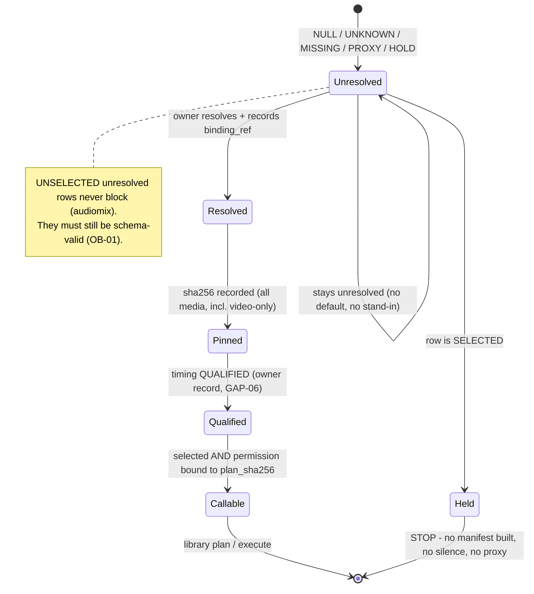

# State and sequence diagrams (design; small)

These show *where each concern is decided* and *how a non-ready outcome travels*. Participants named "owner" are the existing owners; "library" is `video_core` as shipped. Nothing here is implemented by this job.

## 1. Lifecycle of one selected row (what may reach the library)



## 2. Cross-stage sequence (who checks what; ✘ = nobody inside the library)

```mermaid
sequenceDiagram
    autonumber
    participant S as Selection/binding owner
    participant I as Ingestion owner
    participant C as Caller (runs the CLIs)
    participant V as video_core (video-only)
    participant A as audiomix
    participant M as avmux
    S->>C: snapshot ref, selected rows, state, binding_ref, timing qualification
    I->>C: files + sha256 (read-only)
    C->>C: HOLD if a SELECTED row is unresolved / unqualified / unpinned (✘ not expressible in the library)
    C->>V: validate, plan (episode from selected rows)
    V-->>C: plan_sha256 (no source hash ✘ GAP-02), -an
    C->>A: validate, plan (+ --episode)
    A-->>C: READY (exit 0) or HOLD (exit 5; mix dry-run exits 0!)
    C->>C: read status, not exit code; warnings => stop; permission == plan_sha256
    Note over C,A: execution flags --render / --mix / --mux are NOT used by this job
    A-->>C: stem + receipt (status string, unauthenticated)
    C->>C: bind receipt to own run record (✘ avmux compares only status, stem sha256, sample_count)
    C->>M: plan (video sha256 + declared props, stem, receipt?)
    M-->>C: exit 0 but readiness "UNVERIFIED" (video hashed but never parsed ✘ GAP-03)
    C->>M: mux --mux preflight (ffprobe measures) — not run in this job
    M-->>C: technical verdict only; creative_acceptance NOT_EVALUATED
    C->>S: outcome; promotion needs creative approval (owner record, ✘ GAP-11)
```

## 3. How a non-ready outcome propagates (ASCII, terminal-friendly)

```text
 selected row UNKNOWN/MISSING/PROXY ──► audiomix plan: HOLD (exit 5)   dry-run: HOLD but exit 0 (GAP-08)
                                    └─► avmux manifest state: reject input_state_not_use (exit 1)  (GAP-10)
                                    └─► video-only: cannot be said; missing file => reject asset_missing; proxy/colour stand-in ACCEPTED (GAP-01)
 audio mix fails / partial / IN_PROGRESS / UNKNOWN ─► stem.wav.partial: refused (extension)      stem absent: asset_missing
                                                   └► receipt given, not MIXED_VERIFIED: refused  receipt omitted: ACCEPTED (GAP-04)
 receipt wrong JSON shape ─► avmux plan crashes (exit 1, empty stdout)                          (GAP-14)
 source bytes changed ─► audiomix/avmux: sha256 mismatch (reject)    video-only: plan unchanged (GAP-02)
 output name exists / inside asset root ─► every stage rejects; previous output untouched
 failure anywhere ─► owner keeps the failed dir as evidence, uses a NEW output name, restores pointers from hashed backup (rollback)
```
